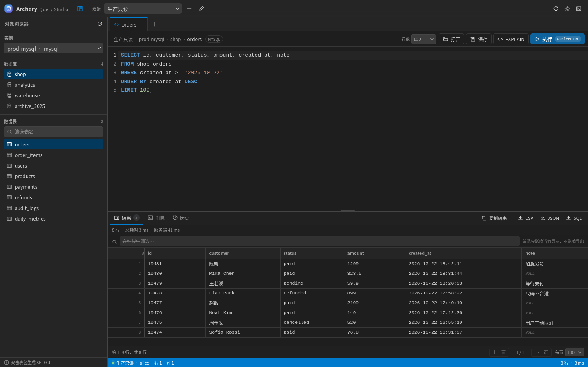
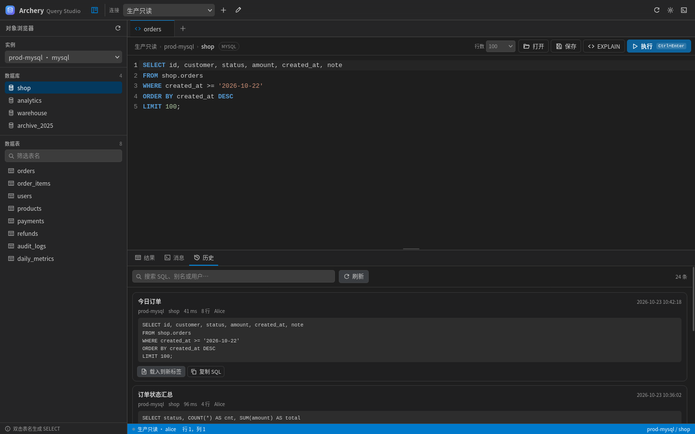
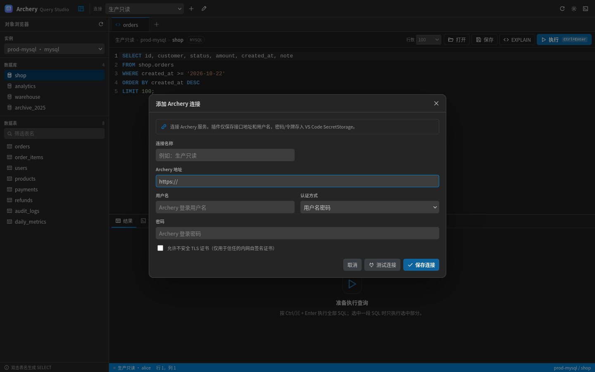
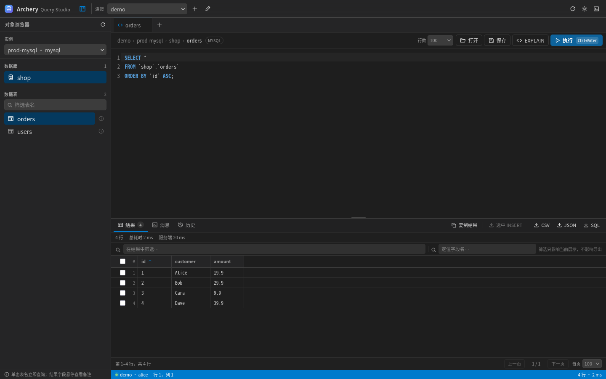
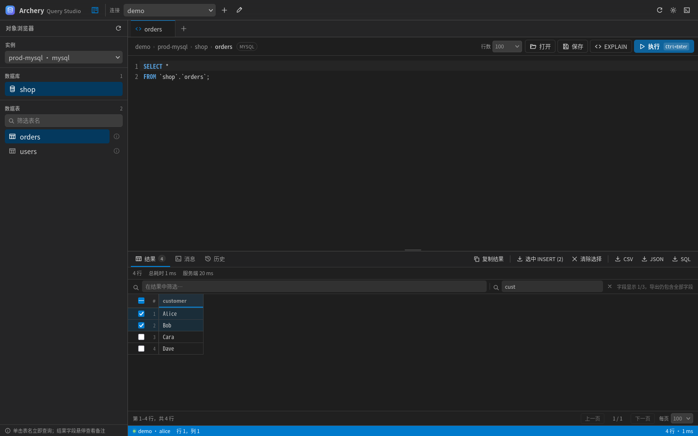
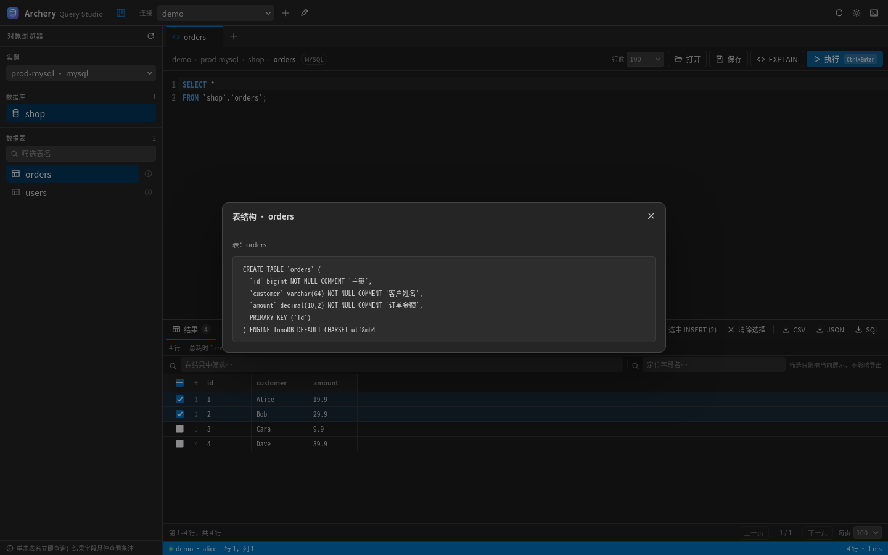
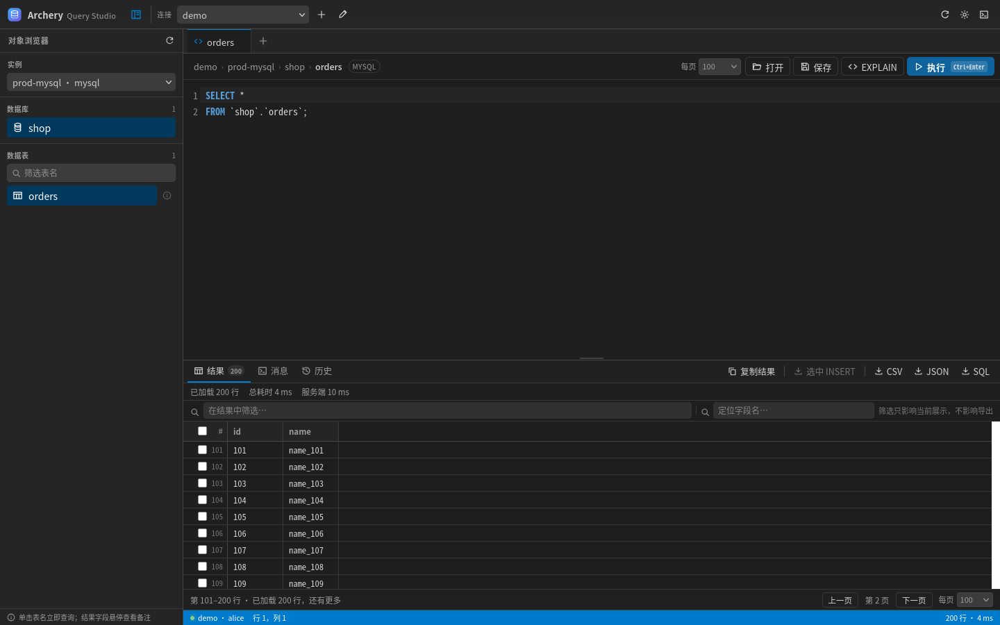
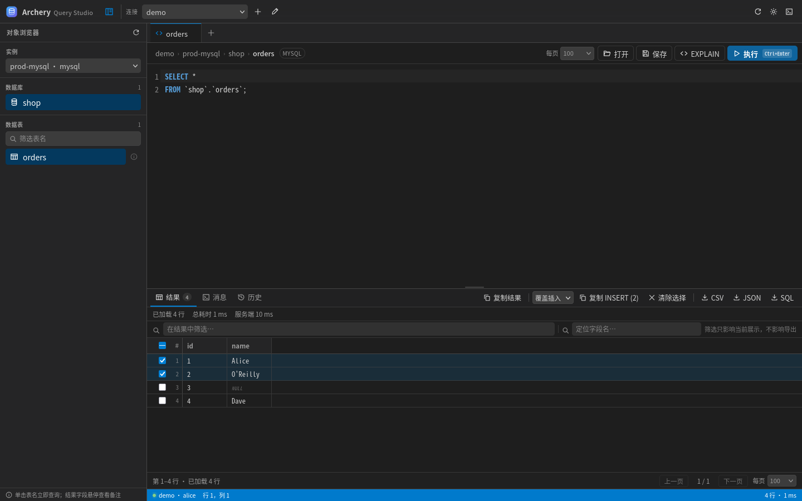
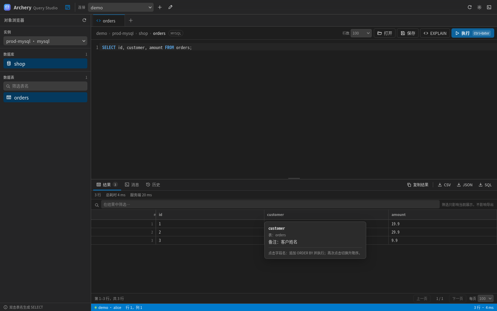
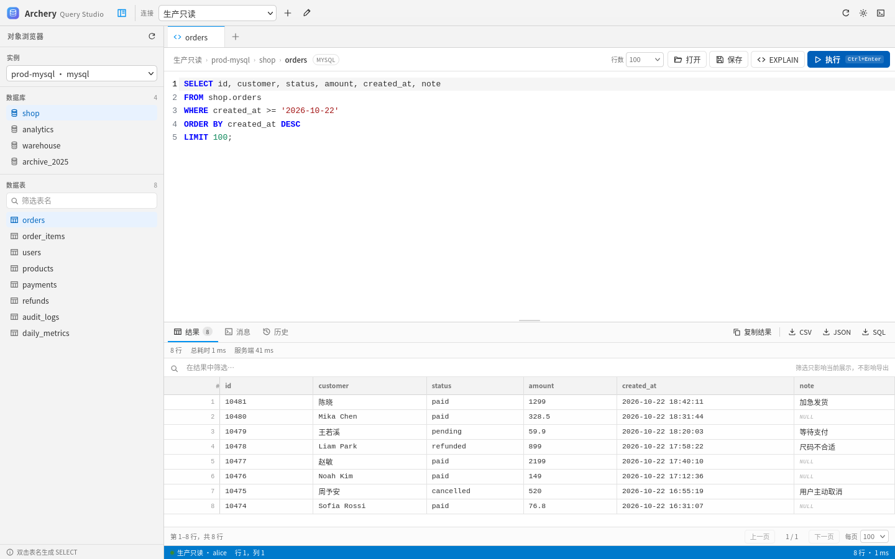

# Archery Query Studio

在 VS Code 里通过 [Archery](https://github.com/hhyo/Archery) 浏览数据库对象、编写并执行 SQL、查看和导出结果。交互方式参考 HeidiSQL 的“对象树 + SQL 编辑器 + 结果表格”，但**不在本地直连数据库**，所有查询都经过 Archery 的权限校验、审计、脱敏与限流。



## 功能

- **多连接管理**：保存多个 Archery 地址与账号；密码/访问令牌写入 VS Code SecretStorage，不进入普通配置文件。
- **对象浏览器**：按需加载实例、数据库、Schema、表与字段；支持 PostgreSQL / GaussDB 的 Schema 层级，并兼容 Oracle 以 owner 作为数据库层级的资源结构。
- **侧边栏对象树**：VS Code 活动栏中的 Archery 树，支持右键新建查询、生成 `SELECT`、查看表结构、复制名称和刷新节点。
- **SQL 工作台**：CodeMirror 6 编辑器，SQL 语法高亮、表名/字段/SQL 关键字补全、选区执行、多查询标签页；单击数据表即可立即查询，表项右侧可查看表结构。
- **结果表格**：列宽自适应、行筛选、字段名定位筛选、点击字段名循环切换正序/倒序/取消排序、悬停查看字段备注、单击单元格复制原始数据、双击单元格在页面内修改并生成 UPDATE、勾选行直接复制 INSERT、分页。
- **结果导出**：CSV（含 BOM，方便 Excel 打开）、JSON、SQL `INSERT` 脚本；导出前可另存为任意本地文件。
- **查询历史**：读取 Archery 服务端查询历史，按 SQL / 别名 / 用户搜索，一键载入到新标签。
- **EXPLAIN**：对当前 SQL 或选中 SQL 快速执行 `EXPLAIN`。
- **SQL 文件**：从文件打开 SQL、保存当前编辑器内容为 `.sql`。
- **兼容旧版 Archery**：自动探测并同时支持新版 `/api/v1/sqlquery/*` 接口与 Archery 1.14 的 Legacy 接口。
- **安全失败**：2FA / SSO 登录、TLS 证书错误、CSRF 校验失败、会话过期等情况都有明确提示，不会静默降级或绕过认证。



## 安装

### 从 VSIX 安装

```bash
npm install
npm run package
code --install-extension archery-query-studio-0.1.26.vsix
```

也可以直接在 VS Code 中打开 `.vsix` 文件安装。

### 开发模式

```bash
npm install
npm run compile
```

用 VS Code 打开本目录，按 `F5` 启动 Extension Development Host。

## 快速开始

1. 点击活动栏的 **Archery 查询** 图标，或命令面板执行 `Archery: 添加 Archery 连接`。
2. 填写：
   - **Archery 地址**：例如 `https://archery.example.com`。如果服务部署在子路径，也可以填 `https://example.com/archery`。
   - **用户名 / 密码**：Archery 网页登录使用的账号。
   - **访问令牌**（可选）：新版 Archery 支持 JWT 时，可以改为 Bearer Token 模式。
3. 点击 **测试连接**，确认可见实例数量后保存。
4. 在对象浏览器选择实例和数据库，编写 SQL，按 `Ctrl/⌘ + Enter` 执行；选中一部分 SQL 时只执行选中的内容。
5. 在结果区筛选、排序、复制，或导出 CSV / JSON / SQL。



## 数据表查询、字段定位与表结构

- **单击表名立即查询**：在左侧“数据表”列表单击表名，会新建一个查询标签，自动写入并执行 `SELECT * FROM ...`。
- **字段名定位**：结果上方提供“定位字段名…”输入框。输入部分字段名后，只显示匹配的字段，并在表头高亮；按 `Esc` 或点击 `×` 恢复全部字段。字段筛选只影响显示，复制和导出仍包含全部字段。
- **三态排序**：点击字段名按“正序 → 倒序 → 取消排序”循环，排序图标显示在字段标题右侧；每次切换都会更新执行框中的 `ORDER BY` 并重新执行。


- **查看表结构**：在左侧“数据表”列表项右侧点击信息图标，打开该表的建表 DDL 或字段明细弹窗。
- **选中行导出**：结果左侧支持勾选行/本页全选；点击“选中 INSERT”只导出所选行的 `INSERT` 语句，支持跨页选择，“清除选择”可一次清空。





### Redis 实例

当 Archery 实例的 `db_type` 为 `redis` 时，对象浏览器会自动切换为 Redis 兼容模式：

- 数据库列表显示 `db0[100]` 这类 Redis DB 及 Key 数量；
- “数据表”区域切换为 `Redis Keys`；
- 输入 Key 模式后自动执行 `SCAN` 搜索，支持 `*`、`?` 等 Redis 通配符；不含通配符时自动前后匹配；
- 单击 Key 会自动先执行 `TYPE "key"`，再按类型组装并执行查询：
  - string → `GET "key"`
  - hash → `HGETALL "key"`
  - list → `LRANGE "key" 0 999`
  - set → `SMEMBERS "key"`
  - zset → `ZRANGE "key" 0 999 WITHSCORES`
  - stream → `XRANGE "key" - + COUNT 1000`
- 组装后的命令会显示在 SQL 编辑器中，结果直接展示在结果集，标签页标题会带上 Key 类型；
- Redis 模式下不显示表结构按钮、正则切换和表名筛选历史。

## 左侧对象浏览器宽度

对象浏览器右侧有一条可拖动的分隔条：

- 按住并左右拖动可调整数据库/数据表列表宽度；
- 双击分隔条恢复默认宽度；
- 宽度会保存在本地，重新打开工作台后自动恢复；
- 表名和数据库名会自动换行，过长的名称也可以完整展示，不再只显示省略号。

## 表结构搜索

表结构弹窗顶部提供关键词搜索框，可搜索字段名、类型、备注和 DDL 内容：

- 输入关键词后高亮所有匹配字符，当前匹配使用更明显的选中高亮；
- 自动将当前匹配滚动到可视区域中央；
- 显示当前匹配序号和总数（按字符出现次数计算）；
- `Enter` 跳到下一处，`Shift + Enter` 跳到上一处；
- 也可使用上下箭头和清除按钮。

## 查询标签右键菜单

右键单击查询标签，可以：

- 关闭此标签；
- 关闭其他标签；
- 关闭右侧标签。

关闭标签时会取消该标签正在执行的请求；如果关闭了当前活动标签，会自动切换到目标标签或相邻标签。

## 数据表筛选与正则

数据表筛选框默认按表名子串匹配。点击输入框右侧的 `.*` 按钮可切换为正则模式，按钮上会显示当前为“普通”或“正则”状态：

- 正则匹配忽略大小写；
- 例如 `^user_\d+$` 只匹配 `user_1`、`user_2`；
- 支持 `^`、`$`、分组、字符类等 JavaScript 正则语法；
- 正则表达式无效时，筛选框变红并提示错误，不会执行错误匹配；
- 正则筛选记录会以 `/pattern/` 形式保存在筛选历史中。

## 数据表筛选历史

“数据表”筛选框会记录最近 **30 条**表名筛选记录，点击筛选框右侧的时钟图标即可查看和重新应用。记录按时间倒序、自动去重，并随工作台状态持久化。

- 按 `Enter` 或点击筛选后的数据表时记录；
- 点击历史项会恢复该筛选并过滤数据表；
- 支持清空全部筛选历史。

## 在页面内修改单元格

双击结果集中的数据单元格即可就地编辑：

- 单击选中单元格，`Ctrl/⌘ + C` 复制原始数据；
- 修改只发生在当前页面，不会自动执行 SQL；
- 按 `Enter` 或点击其他位置提交，按 `Esc` 取消；
- 修改过的单元格左上角显示橙色小三角，并保留浅色背景；点击其他单元格会提交当前编辑；
- 结果操作栏出现“复制 UPDATE (N)”按钮，`N` 为涉及的修改行数；
- 点击后按主键生成所有变更的 `UPDATE` 语句；拿不到主键时使用修改前整行数据作为条件；
- 生成的内容只复制到剪贴板，不会自动执行。

`Ctrl/⌘ + 双击` 仍可打开单元格完整内容查看器。

## 结果翻页

结果底部的“上一页 / 下一页”用于浏览当前结果。首次执行只加载当前每页行数；点击“下一页”时会继续从 Archery 读取更多行，最多累计加载 5000 行。顶部和底部的“每页”选择保持同步，修改后会重新加载第一页。

底部会显示当前页范围、已加载行数和是否还有更多。存在行筛选时，清除结果筛选后可继续加载后续页。



### 选中行复制 INSERT / DELETE

在结果行左侧勾选一行或多行（表头复选框可选择当前页全部行），点击 **更多操作** 下拉菜单，在“复制选中行 SQL”分类中选择普通/覆盖/忽略插入，即可把已选行直接复制到剪贴板；选择“复制 DELETE”可生成对应行的删除 SQL。CSV、JSON、SQL 导出也收纳在“导出当前结果”分类中。支持跨页选择，复制内容使用当前结果的全部字段，不受字段定位筛选影响。

单击行号可切换该行的选中状态；也可以使用左侧复选框，或按住鼠标拖动框选多行，按住 `Ctrl/⌘` 拖动可追加选择。单击数据单元格会选中该单元格，但不会切换行选中；选中后按 `Ctrl/⌘ + C` 复制原始数据；双击进入编辑。

- **普通插入**：`INSERT INTO ...`
- **覆盖插入**：MySQL/MariaDB 使用 `REPLACE INTO ...`
- **忽略插入**：MySQL/MariaDB 使用 `INSERT IGNORE ...`

> 覆盖/忽略模式仅支持 MySQL/MariaDB；其他数据库只保留普通插入。

DELETE 会优先使用表结构中的主键列；拿不到主键时使用全部字段生成条件。字段条件使用 `=`，值为 NULL 时使用 `IS NULL`，不再追加 `LIMIT 1`。



## 字段备注提示

把鼠标移到结果表格的字段名上，会显示：

- 字段名称
- 所属表
- 字段备注
- 点击字段名追加 `ORDER BY` 的操作提示



备注来自当前结果关联表的 Archery 表结构元数据：

- MySQL / MariaDB：解析 `SHOW CREATE TABLE` 中的 `COMMENT`；
- PostgreSQL / GaussDB：读取 `information_schema.columns` 描述结果中的注释列；
- Oracle：读取 `all_col_comments` 描述结果中的注释列。

因此，结果需要关联到具体表（例如从对象树打开表或点击侧边栏表名）。完全手写、未关联具体表的 SQL 无法自动确定字段备注，此时提示会说明“当前结果未关联具体表”。MSSQL 等描述接口未返回注释的数据库会显示“该字段暂无备注”。

## 常用操作

| 操作 | 方式 |
| --- | --- |
| 执行全部/选中 SQL | `Ctrl/⌘ + Enter` |
| 只执行选中 SQL | `Ctrl/⌘ + Shift + Enter` |
| 保存 SQL 文件 | `Ctrl/⌘ + S`（编辑器内）或工具栏“保存” |
| 新建查询标签 | 查询标签栏的 `+` |
| 立即查询数据表 | 单击侧边栏“数据表”中的表名，自动创建并执行 `SELECT *` |
| 定位结果字段 | 结果上方“定位字段名…”输入框，按 Esc 清除 |
| 查看表结构 | 左侧“数据表”列表项右侧的信息图标，或对象树右键“查看表结构” |
| 搜索表结构 | 表结构弹窗顶部输入关键词，Enter 跳转下一处 |
| 排序结果字段 | 点击结果字段名，正序 → 倒序 → 取消排序循环 |
| 选中行复制 INSERT | 勾选结果左侧复选框，打开“更多操作”→“复制选中行 SQL”→选择插入模式 |
| 选中行复制 DELETE | 勾选结果左侧复选框，打开“更多操作”→“复制选中行 SQL”→“复制 DELETE” |
| 复制单元格原始数据 | 单击单元格选中，按 Ctrl/⌘ + C 复制原始数据 |
| 结果行选中 | 单击行号切换该行选中；拖动可框选，Ctrl/⌘ 拖动追加，也可使用左侧复选框 |
| 表名筛选历史 | 点击筛选框右侧时钟图标，查看最近 30 条记录 |
| 表名正则筛选 | 点击筛选框右侧 `.*` 后输入正则表达式 |
| 调整左侧宽度 | 拖动对象浏览器右侧分隔条；双击恢复默认 |
| 批量关闭标签 | 右键单击查询标签，选择“关闭其他标签”或“关闭右侧标签” |
| 结果翻页 | 结果底部“上一页 / 下一页”，或修改“每页”行数 |
| 编辑单元格 | 双击数据单元格，输入后按 Enter 提交，Esc 取消 |
| 复制全部修改为 UPDATE | 修改后点击结果操作栏“复制 UPDATE (N)” |
| 查看单元格完整内容 | Ctrl/⌘ + 双击结果单元格 |
| 展开/收起对象浏览器 | 标题栏左侧按钮 |

## 命令

| 命令 | 说明 |
| --- | --- |
| `Archery: 添加 Archery 连接` | 新建连接并测试登录 |
| `Archery: 打开 SQL 查询工作台` | 打开/聚焦查询工作台 |
| `Archery: 新建查询` | 从当前树节点上下文新建查询 |
| `Archery: 查询前 100 行` | 为表生成并自动执行 `SELECT *` |
| `Archery: 查看表结构` | 通过 Archery 获取表结构 |
| `Archery: 刷新 Archery 对象树` | 清空缓存并重新加载 |
| `Archery: 查看 Archery 插件日志` | 打开 Output 面板，便于排查网络/认证问题 |

## 配置

| 设置 | 默认值 | 说明 |
| --- | --- | --- |
| `archeryQueryStudio.defaultLimit` | `100` | 新查询默认每页加载行数（1–5000） |
| `archeryQueryStudio.requestTimeout` | `120` | 请求超时（秒），包括查询执行 |
| `archeryQueryStudio.historyLimit` | `100` | 历史记录每次加载条数 |
| `archeryQueryStudio.allowInsecureTls` | `false` | 全局允许自签名/无效 TLS 证书；也可按连接单独开启 |

> 分页会按需继续读取更多行，单次查询累计最多加载 5000 行；上限最终仍受 Archery 的查询权限和 `limit_num` 策略限制。

## Archery API 兼容性

插件按以下顺序做能力探测：

1. 通过 `GET /login/` 获取 CSRF Token，再 `POST /authenticate/` 建立 Archery Session；
2. 使用 `GET /api/v1/sqlquery/instances/` 探测新版接口；
3. 若新版接口不存在或不可用，自动回退到 Legacy 接口。

| 能力 | 新版接口 | Legacy（Archery 1.14 等） |
| --- | --- | --- |
| 实例列表 | `GET /api/v1/sqlquery/instances/` | `GET /group/user_all_instances/` |
| 数据库/Schema/表/字段 | `GET /api/v1/sqlquery/resources/` | `GET /instance/instance_resource/` |
| 执行查询 | `POST /api/v1/sqlquery/execute/` | `POST /query/` |
| 表结构 | `POST /api/v1/sqlquery/describetable/` | `POST /instance/describetable/` |
| 查询历史 | `GET /api/v1/sqlquery/logs/` | `GET /query/querylog/` |

认证说明：

- **用户名密码模式**：使用 Archery Web 登录接口；会话失效后自动重新登录并重试安全请求。
- **访问令牌模式**：直接发送 `Authorization: Bearer <token>`，适用于开放 JWT 的新版 Archery，不再调用 `/authenticate/`。
- **暂不支持两步验证（2FA）登录**。如果账号启用两步验证，请为插件使用单独的服务账号，或改用访问令牌模式。
- **暂不支持 CAS / OIDC / 钉钉扫码登录**；这些部署可使用访问令牌模式（若服务端已启用 JWT API）。

## 安全设计

- 不直连任何数据库，只访问 Archery HTTP(S) 接口。
- 密码和 Token 只存 SecretStorage；工作区设置和 `globalState` 中不保存凭据。
- 日志不记录密码、Token 和完整 SQL；只记录请求路径、状态码和错误摘要。
- 默认严格校验 TLS；开启“不安全 TLS”时会显示警告。
- 使用 HTTP 地址时，连接表单会提示密码将明文传输。
- Webview 启用 CSP，不使用远程资源；结果渲染使用 `textContent`，避免把数据库内容当 HTML 执行。
- 导出的 CSV/JSON/SQL 只写入用户通过保存对话框选择的路径。

## 常见问题：Archery 连接被重置

如果出现 **“Archery 连接被重置”**，通常是以下原因：

- 负载均衡 / Nginx 等反向代理关闭了空闲的 keep-alive 连接；
- Archery 服务重启、发布或容器漂移；
- VPN、防火墙、企业零信任网关中断了长连接；
- 网络抖动，或服务端在返回响应前主动断开。

从 **0.1.1** 起，插件会：

- 对实例列表、数据库/表、查询历史等安全的 **GET** 请求自动重试（最多 2 次）；
- 对登录、表结构等安全的 **POST** 请求自动重试；
- **不会自动重试执行 SQL 的 POST 请求**，避免服务端已经执行而客户端未收到响应时重复执行。

如果错误在执行 SQL 时出现，请先确认服务端是否已执行（查看 Archery 查询历史和数据库状态），再手动点击执行。持续出现时，建议检查 Archery 前面反向代理的 `keepalive_timeout`、`proxy_read_timeout` 和网络链路。插件日志中会记录重试次数和请求路径，但不会记录密码或完整 SQL。

## 已知限制

- **停止按钮只中断本地 HTTP 等待**：Archery 是异步审计平台，服务端 SQL 仍可能继续执行，直到服务端超时。建议结合 Archery 的查询超时和审计策略使用。
- 结果最多展示 5000 行；更大的数据请使用 Archery 的导出工单或数据库侧导出。
- 导出是客户端行为，不会触发 Archery 的导出审批流程。生产环境请遵守团队的数据导出规范。
- 不支持事务控制；Archery 查询接口本身定位为查询/审核入口。
- 暂不支持 HTTP 代理配置，依赖 VS Code / 系统网络环境。
- 未集成工单提交、SQL 审核、慢日志、会话管理等 Archery 其他模块。

## 开发

```bash
npm install
npm run check       # TypeScript 类型检查
npm test            # Vitest：API 客户端、归一化、扩展激活、连接存储
npm run compile     # esbuild 打包 dist/extension.js 与 dist/webview.js
npm run package     # 生成 .vsix
```

目录结构：

```
src/
  archery/        HTTP、Cookie、登录、双版 API 适配、结果归一化
  services/       连接存储、Archery 服务、日志
  tree/           VS Code 对象树
  webview/        Webview 宿主、消息协议
webview/          SQL 工作台前端（CodeMirror、结果表格、历史、连接表单）
test/             单元与集成测试（含本地 Mock Archery 服务）
media/            扩展图标
docs/             截图
```

### 测试覆盖

- 登录、CSRF、Cookie、会话过期自动重登；
- 新版 v1 与 Legacy 接口自动回退；
- 查询执行、表结构、历史记录；
- 对象行 / 数组行等不同 Archery 引擎返回格式；
- 查询中断；
- VS Code 扩展激活、命令注册、Webview 创建；
- SecretStorage 密码隔离与编辑保留。

## 说明

本项目是独立的 VS Code 扩展，与 Archery 官方、HeidiSQL 无隶属关系。Archery 是 hhyo/Archery 的开源项目，使用其 API 时请遵守所在团队的权限、审计与合规要求。



## License

MIT
